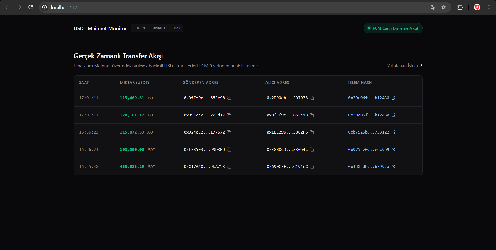

## Mimari Akış



```text
Ethereum Mainnet (USDT ERC-20)
        │  WebSocket (Alchemy WSS)
        ▼
Backend (NestJS + Ethers.js v6)
  ├─ Transfer event dinleme
  ├─ decimals = 6 (BigInt) ile >= 100.000 USDT filtreleme
  └─ Firebase Admin SDK (sendEachForMulticast)
        │  FCM Push Notification + Data Payload
        ▼
Frontend (React + Vite + Firebase Web SDK)
  ├─ Bildirim izni & Device Token kaydı (POST /notifications/subscribe)
  └─ Canlı Transfer Tablosu (Gönderen, Alıcı, Miktar, Etherscan Tx Hash)
```

---

## Kullanılan Teknolojiler

* **Backend:** NestJS, TypeScript, Ethers.js (v6), Firebase Admin SDK, `@nestjs/config`
* **Frontend:** React, TypeScript, Vite, Firebase Web SDK (FCM), Lucide Icons
* **Altyapı & Servisler:** Alchemy (Ethereum Mainnet WebSocket RPC), Firebase Cloud Messaging (FCM)

---

## Proje Yapısı

```plaintext
/backend   → NestJS kaynak kodları (Blockchain dinleme ve FCM bildirim servisi)
/frontend  → React + Vite web uygulaması (Anlık bildirim ve transfer listesi)
```

---

## Kurulum ve Çalıştırma

### Ön Gereksinimler

* Node.js (`v18+` önerilir)
* Alchemy üzerinden alınmış Ethereum Mainnet WebSocket (`wss://`) URL'i
* Firebase Console projesi (Web App Config, VAPID Key ve Admin SDK Service Account JSON)

### 1. Backend Kurulumu (`/backend`)

```bash
cd backend
npm install
```

1. **Firebase Console → Project Settings → Service Accounts** üzerinden indirdiğiniz gizli anahtar dosyasını `backend/firebase-service-account.json` adıyla kaydedin.
2. `.env.example` dosyasını kopyalayarak `.env` dosyasını oluşturun ve değerleri doldurun:

```env
PORT=3001
ALCHEMY_WSS_URL=wss://[eth-mainnet.g.alchemy.com/v2/YOUR_ALCHEMY_API_KEY](https://eth-mainnet.g.alchemy.com/v2/YOUR_ALCHEMY_API_KEY)
USDT_CONTRACT_ADDRESS=0xdAC17F958D2ee523a2206206994597C13D831ec7
MIN_USDT_AMOUNT=100000
FCM_TOPIC=usdt-transfers
FIREBASE_SERVICE_ACCOUNT_PATH=./firebase-service-account.json
```

3. Backend sunucusunu başlatın:

```bash
npm run start:dev
```

### 2. Frontend Kurulumu (`/frontend`)

```bash
cd frontend
npm install
```

1. `.env.example` dosyasını kopyalayarak `.env` dosyasını oluşturun ve Firebase Web App bilgilerinizi girin:

```env
VITE_API_URL=http://localhost:3001
VITE_FIREBASE_API_KEY=...
VITE_FIREBASE_AUTH_DOMAIN=...
VITE_FIREBASE_PROJECT_ID=...
VITE_FIREBASE_STORAGE_BUCKET=...
VITE_FIREBASE_MESSAGING_SENDER_ID=...
VITE_FIREBASE_APP_ID=...
VITE_FIREBASE_VAPID_KEY=...
```

2. `frontend/public/firebase-messaging-sw.js` dosyasındaki Firebase yapılandırma alanlarını kendi proje bilgilerinizle güncelleyin.
3. Frontend uygulamasını başlatın:

```bash
npm run dev
```

Tarayıcıda `http://localhost:5173` adresini açın, sağ üstteki **"Bildirimleri Etkinleştir"** butonuna tıklayıp bildirim izni verin. Eşik değeri üzerindeki USDT transferleri gerçekleştiği anda ekrana düşecektir.

---

## Teknik Notlar

* **USDT Decimals (6):** ERC-20 USDT kontratı 6 ondalık basamak kullandığından, hassasiyet kaybını önlemek için eşik kontrolü `ethers.parseUnits('100000', 6)` ile `BigInt` seviyesinde yapılmaktadır.
* **FCM Payload:** FCM protokolünde `from` anahtarı rezerve olduğu için veri yükünde `fromAddress` ve `toAddress` alanları kullanılmıştır.
* **Token Yönetimi:** Frontend'den gelen FCM Device Token'ları backend'de tekilleştirilerek saklanır; bildirim gönderimi sırasında geçersiz/süresi dolmuş token'lar otomatik temizlenir.